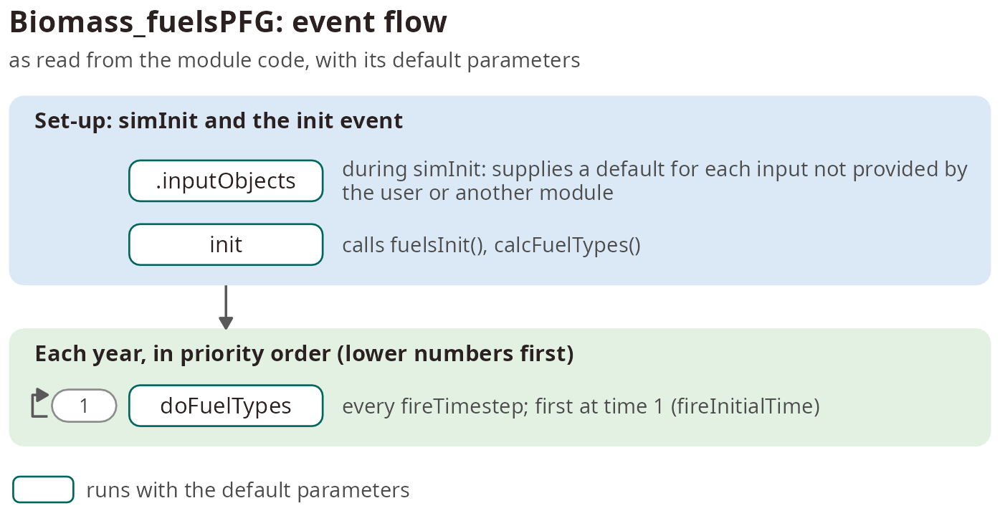
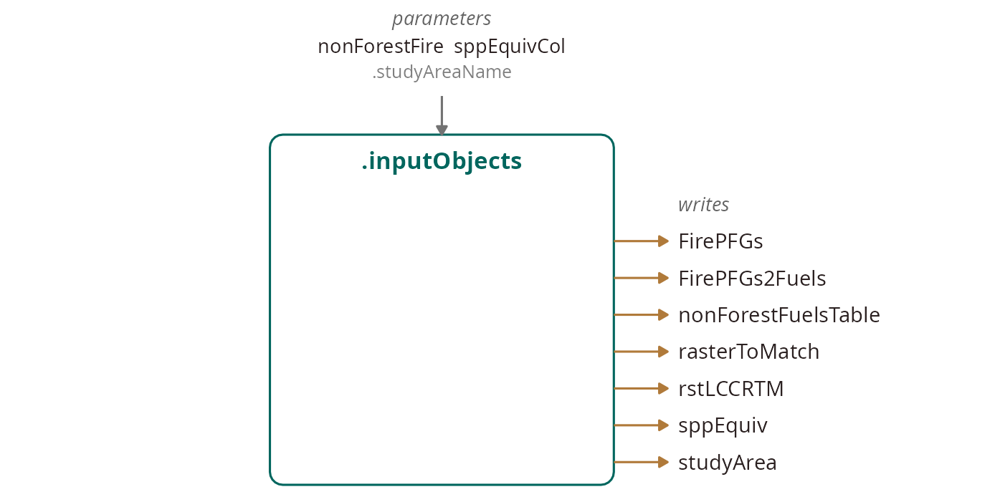
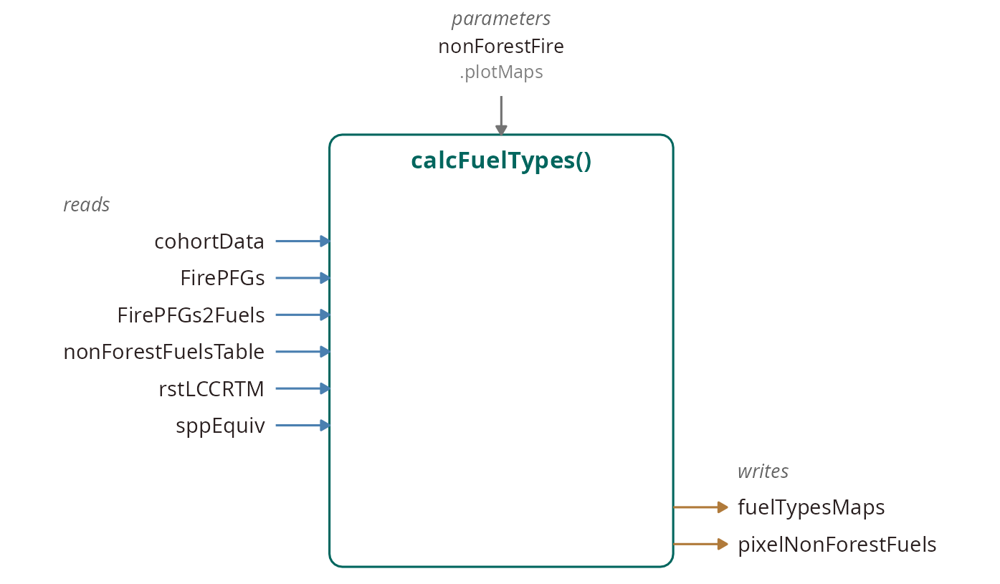
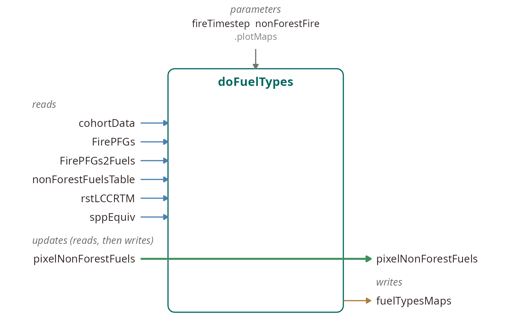

# Biomass_fuelsPFG Module

<!-- the following are text references used in captions for LaTeX compatibility -->
(ref:Biomass-fuelsPFG) *Biomass_fuelsPFG*

<!-- if knitting to pdf remember to add the pandoc_args: ["--extract-media", "."] option to yml in order to get the badge images -->

#### Authors:

Ceres Barros <cbarros@mail.ubc.ca> [aut, cre], Eliot J B McIntire <eliot.mcintire@canada.ca> [ctb], Steven Cumming <stevec@sbf.ulaval.ca> [ctb]
<!-- ideally separate authors with new lines, '\n' not working -->

## Module Overview

### Module summary

Provide a brief summary of what the module does / how to use the module.

Module documentation should be written so that others can use your module.
This is a template for module documentation, and should be changed to reflect your module.

### Module inputs and parameters

Describe input data required by the module and how to obtain it (e.g., directly from online sources or supplied by other modules)
If `sourceURL` is specified, `downloadData("Biomass_fuelsPFG", "..")` may be sufficient.

Table \@ref(tab:moduleInputs-Biomass-fuelsPFG) shows the full list of module inputs.

<table class="table" style="margin-left: auto; margin-right: auto;">
<caption>(\#tab:moduleInputs-Biomass-fuelsPFG)(\#tab:moduleInputs-Biomass-fuelsPFG)List of (ref:Biomass-fuelsPFG) input objects and their description.</caption>
 <thead>
  <tr>
   <th style="text-align:left;"> objectName </th>
   <th style="text-align:left;"> objectClass </th>
   <th style="text-align:left;"> desc </th>
   <th style="text-align:left;"> sourceURL </th>
  </tr>
 </thead>
<tbody>
  <tr>
   <td style="text-align:left;"> cohortData </td>
   <td style="text-align:left;"> data.table </td>
   <td style="text-align:left;"> age cohort-biomass table hooked to pixel group map by pixelGroupIndex at succession time step </td>
   <td style="text-align:left;"> NA </td>
  </tr>
  <tr>
   <td style="text-align:left;"> FirePFGs </td>
   <td style="text-align:left;"> data.table </td>
   <td style="text-align:left;"> Table of fire-related plant functional groups, with species and age composition per group. </td>
   <td style="text-align:left;"> https://drive.google.com/file/d/1xsNfPLy91D3VxMASAH4_-PUWs3HQWqBx/view?usp=sharing </td>
  </tr>
  <tr>
   <td style="text-align:left;"> FirePFGs2Fuels </td>
   <td style="text-align:left;"> data.table </td>
   <td style="text-align:left;"> Table of correspondence between fire plant functional groups and FBP fuel types (using fuel types from CF Fire Behaviour Prediction System (2nd Ed.)). The table includes (minimum) thresholds of abundance that each group must have in order to apply a particular fuel type to a stand. </td>
   <td style="text-align:left;"> https://drive.google.com/file/d/1nkKTsxPIpIvjwLsiMu6NrWv52c498UKx/view?usp=sharing </td>
  </tr>
  <tr>
   <td style="text-align:left;"> nonForestFuelsTable </td>
   <td style="text-align:left;"> data.table </td>
   <td style="text-align:left;"> Table of correspondence between non-forested land-cover classes and fire fuels. Fuel types come from CF Fire Behaviour Prediction System (2nd Ed.). Default values use the LCC2005 land-cover product, and consider only grasslands and shurblands. </td>
   <td style="text-align:left;"> NA </td>
  </tr>
  <tr>
   <td style="text-align:left;"> rasterToMatch </td>
   <td style="text-align:left;"> RasterLayer </td>
   <td style="text-align:left;"> a raster of the studyArea in the same resolution and projection as biomassMap </td>
   <td style="text-align:left;"> NA </td>
  </tr>
  <tr>
   <td style="text-align:left;"> rstLCCRTM </td>
   <td style="text-align:left;"> RasterLayer </td>
   <td style="text-align:left;"> A land classification map in study area, masked to rasterToMatch It must be 'corrected', in the sense that: 1) Every class must not conflict with any other map in this module (e.g., speciesLayers should not have data in LCC classes that are non-treed); 2) It can have treed and non-treed classes. The non-treed will be removed within this module if P(sim)$omitNonTreedPixels is TRUE; 3) It can have transient pixels, such as 'young fire'. These will be converted to a the nearest non-transient class, probabilistically if there is more than 1 nearest neighbour class, based on P(sim)$LCCClassesToReplaceNN. The default layer used, if not supplied, is Canada national land classification in 2005 </td>
   <td style="text-align:left;"> https://drive.google.com/file/d/1g9jr0VrQxqxGjZ4ckF6ZkSMP-zuYzHQC/view?usp=sharing </td>
  </tr>
  <tr>
   <td style="text-align:left;"> studyArea </td>
   <td style="text-align:left;"> SpatialPolygonsDataFrame </td>
   <td style="text-align:left;"> Polygon of the study area. Required to make `rstLCCRTM` when it is not supplied; its hash is the default `.studyAreaName`. </td>
   <td style="text-align:left;"> NA </td>
  </tr>
  <tr>
   <td style="text-align:left;"> sppEquiv </td>
   <td style="text-align:left;"> data.table </td>
   <td style="text-align:left;"> table of species equivalencies. See LandR::sppEquivalencies_CA. </td>
   <td style="text-align:left;"> NA </td>
  </tr>
</tbody>
</table>

Summary of user-visible parameters (Table \@ref(tab:moduleParams-Biomass-fuelsPFG))

<table class="table" style="margin-left: auto; margin-right: auto;">
<caption>(\#tab:moduleParams-Biomass-fuelsPFG)(\#tab:moduleParams-Biomass-fuelsPFG)List of (ref:Biomass-fuelsPFG) parameters and their description.</caption>
 <thead>
  <tr>
   <th style="text-align:left;"> paramName </th>
   <th style="text-align:left;"> paramClass </th>
   <th style="text-align:left;"> default </th>
   <th style="text-align:left;"> min </th>
   <th style="text-align:left;"> max </th>
   <th style="text-align:left;"> paramDesc </th>
   <th style="text-align:left;"> cacheKey </th>
  </tr>
 </thead>
<tbody>
  <tr>
   <td style="text-align:left;"> fireInitialTime </td>
   <td style="text-align:left;"> numeric </td>
   <td style="text-align:left;"> 1 </td>
   <td style="text-align:left;"> NA </td>
   <td style="text-align:left;"> NA </td>
   <td style="text-align:left;"> The event time that the first fire disturbance event occurs </td>
   <td style="text-align:left;"> TRUE </td>
  </tr>
  <tr>
   <td style="text-align:left;"> fireTimestep </td>
   <td style="text-align:left;"> numeric </td>
   <td style="text-align:left;"> NA </td>
   <td style="text-align:left;"> NA </td>
   <td style="text-align:left;"> NA </td>
   <td style="text-align:left;"> The number of time units between successive fire events in a fire module </td>
   <td style="text-align:left;"> TRUE </td>
  </tr>
  <tr>
   <td style="text-align:left;"> nonForestFire </td>
   <td style="text-align:left;"> logical </td>
   <td style="text-align:left;"> FALSE </td>
   <td style="text-align:left;"> NA </td>
   <td style="text-align:left;"> NA </td>
   <td style="text-align:left;"> Determines whether fire fuels will be calculated for non-forest pixels. If TRUE, the user should provide fuels table ('nonForestFuelsTable') for non forested land cover classes in accordance to the classes in 'rstLCC' </td>
   <td style="text-align:left;"> TRUE </td>
  </tr>
  <tr>
   <td style="text-align:left;"> .plotMaps </td>
   <td style="text-align:left;"> logical </td>
   <td style="text-align:left;"> TRUE </td>
   <td style="text-align:left;"> NA </td>
   <td style="text-align:left;"> NA </td>
   <td style="text-align:left;"> Controls whether maps should be plotted or not </td>
   <td style="text-align:left;"> TRUE </td>
  </tr>
  <tr>
   <td style="text-align:left;"> sppEquivCol </td>
   <td style="text-align:left;"> character </td>
   <td style="text-align:left;"> Boreal </td>
   <td style="text-align:left;"> NA </td>
   <td style="text-align:left;"> NA </td>
   <td style="text-align:left;"> The column in sim$specieEquivalency data.table to use as a naming convention </td>
   <td style="text-align:left;"> TRUE </td>
  </tr>
  <tr>
   <td style="text-align:left;"> .studyAreaName </td>
   <td style="text-align:left;"> character </td>
   <td style="text-align:left;"> NA </td>
   <td style="text-align:left;"> NA </td>
   <td style="text-align:left;"> NA </td>
   <td style="text-align:left;"> Human-readable name for the study area used. If `NA`, a hash of `studyArea` will be used. </td>
   <td style="text-align:left;"> TRUE </td>
  </tr>
  <tr>
   <td style="text-align:left;"> .useCache </td>
   <td style="text-align:left;"> logical </td>
   <td style="text-align:left;"> init </td>
   <td style="text-align:left;"> NA </td>
   <td style="text-align:left;"> NA </td>
   <td style="text-align:left;"> use caching for the spinup simulation? </td>
   <td style="text-align:left;"> TRUE </td>
  </tr>
</tbody>
</table>

Table \@ref(tab:moduleReqdPkgs-Biomass-fuelsPFG) lists the R packages this module
requires. These are installed and loaded automatically by `simInit()`.

<table class="table" style="margin-left: auto; margin-right: auto;">
<caption>(\#tab:moduleReqdPkgs-Biomass-fuelsPFG)(\#tab:moduleReqdPkgs-Biomass-fuelsPFG)List of (ref:Biomass-fuelsPFG) required packages.</caption>
 <thead>
  <tr>
   <th style="text-align:left;"> packageName </th>
   <th style="text-align:left;"> minVersion </th>
  </tr>
 </thead>
<tbody>
  <tr>
   <td style="text-align:left;"> data.table </td>
   <td style="text-align:left;">  </td>
  </tr>
  <tr>
   <td style="text-align:left;"> dplyr </td>
   <td style="text-align:left;">  </td>
  </tr>
  <tr>
   <td style="text-align:left;"> sn </td>
   <td style="text-align:left;">  </td>
  </tr>
  <tr>
   <td style="text-align:left;"> RColorBrewer </td>
   <td style="text-align:left;">  </td>
  </tr>
  <tr>
   <td style="text-align:left;"> LandR </td>
   <td style="text-align:left;"> 1.0.7.9015 </td>
  </tr>
  <tr>
   <td style="text-align:left;"> SpaDES.core </td>
   <td style="text-align:left;">  </td>
  </tr>
  <tr>
   <td style="text-align:left;"> SpaDES.tools </td>
   <td style="text-align:left;">  </td>
  </tr>
  <tr>
   <td style="text-align:left;"> reproducible </td>
   <td style="text-align:left;">  </td>
  </tr>
</tbody>
</table>

### Events

Describe what happens for each event type.

(\#fig:eventFlow-Biomass-fuelsPFG)(ref:Biomass-fuelsPFG) events, as read from the module code with its default parameters.

Table \@ref(tab:eventObjects-Biomass-fuelsPFG) lists, for each object, the code that writes it and the code that only reads it.

<table class="table" style="width: auto !important; border-bottom: 0;">
<caption>(\#tab:eventObjects-Biomass-fuelsPFG)Where each object of (ref:Biomass-fuelsPFG) is written and read, in run order.</caption>
 <thead>
  <tr>
   <th style="text-align:left;"> Object </th>
   <th style="text-align:left;"> Written by </th>
   <th style="text-align:left;"> Read by </th>
  </tr>
 </thead>
<tbody>
  <tr grouplength="8"><td colspan="3" style="border-bottom: 1px solid;"><strong>Inputs</strong></td></tr>
<tr>
   <td style="text-align:left;padding-left: 2em;" indentlevel="1"> rasterToMatch </td>
   <td style="text-align:left;"> .inputObjects (default) </td>
   <td style="text-align:left;">  </td>
  </tr>
  <tr>
   <td style="text-align:left;padding-left: 2em;" indentlevel="1"> studyArea </td>
   <td style="text-align:left;"> .inputObjects (default) </td>
   <td style="text-align:left;">  </td>
  </tr>
  <tr>
   <td style="text-align:left;padding-left: 2em;" indentlevel="1"> cohortData </td>
   <td style="text-align:left;">  </td>
   <td style="text-align:left;"> init: calcFuelTypes(), doFuelTypes </td>
  </tr>
  <tr>
   <td style="text-align:left;padding-left: 2em;" indentlevel="1"> FirePFGs </td>
   <td style="text-align:left;"> .inputObjects (default) </td>
   <td style="text-align:left;"> init: calcFuelTypes(), doFuelTypes </td>
  </tr>
  <tr>
   <td style="text-align:left;padding-left: 2em;" indentlevel="1"> FirePFGs2Fuels </td>
   <td style="text-align:left;"> .inputObjects (default) </td>
   <td style="text-align:left;"> init: calcFuelTypes(), doFuelTypes </td>
  </tr>
  <tr>
   <td style="text-align:left;padding-left: 2em;" indentlevel="1"> nonForestFuelsTable </td>
   <td style="text-align:left;"> .inputObjects (default) </td>
   <td style="text-align:left;"> init: calcFuelTypes(), doFuelTypes </td>
  </tr>
  <tr>
   <td style="text-align:left;padding-left: 2em;" indentlevel="1"> rstLCCRTM </td>
   <td style="text-align:left;"> .inputObjects (default) </td>
   <td style="text-align:left;"> init: calcFuelTypes(), doFuelTypes </td>
  </tr>
  <tr>
   <td style="text-align:left;padding-left: 2em;" indentlevel="1"> sppEquiv </td>
   <td style="text-align:left;"> .inputObjects (default) </td>
   <td style="text-align:left;"> init: calcFuelTypes(), doFuelTypes </td>
  </tr>
  <tr grouplength="2"><td colspan="3" style="border-bottom: 1px solid;"><strong>Outputs</strong></td></tr>
<tr>
   <td style="text-align:left;padding-left: 2em;" indentlevel="1"> fuelTypesMaps </td>
   <td style="text-align:left;"> init: calcFuelTypes(), doFuelTypes </td>
   <td style="text-align:left;">  </td>
  </tr>
  <tr>
   <td style="text-align:left;padding-left: 2em;" indentlevel="1"> pixelNonForestFuels </td>
   <td style="text-align:left;"> init: calcFuelTypes(), doFuelTypes </td>
   <td style="text-align:left;">  </td>
  </tr>
</tbody>
<tfoot><tr><td style="padding: 0; " colspan="100%">
 Not shown, touching no object in the metadata: init: fuelsInit().</td></tr></tfoot>
</table>

#### .inputObjects {-}

during simInit: defaults for inputs not supplied

{width=100%}

#### calcFuelTypes() {-}

init event, step 2 of 2

{width=100%}

#### doFuelTypes {-}

every fireTimestep; first at time 1 (fireInitialTime)

{width=100%}

### Plotting

Write what is plotted.

### Saving

Write what is saved.

### Module outputs

Description of the module outputs (Table \@ref(tab:moduleOutputs-Biomass-fuelsPFG)).

<table class="table" style="margin-left: auto; margin-right: auto;">
<caption>(\#tab:moduleOutputs-Biomass-fuelsPFG)(\#tab:moduleOutputs-Biomass-fuelsPFG)List of (ref:Biomass-fuelsPFG) outputs and their description.</caption>
 <thead>
  <tr>
   <th style="text-align:left;"> objectName </th>
   <th style="text-align:left;"> objectClass </th>
   <th style="text-align:left;"> desc </th>
  </tr>
 </thead>
<tbody>
  <tr>
   <td style="text-align:left;"> fuelTypesMaps </td>
   <td style="text-align:left;"> list </td>
   <td style="text-align:left;"> List of RasterLayers of fuel types and coniferDominance per pixel. </td>
  </tr>
  <tr>
   <td style="text-align:left;"> pixelNonForestFuels </td>
   <td style="text-align:left;"> data.table </td>
   <td style="text-align:left;"> Table of non forest fuel attributes (pixel ID, land cover, fuel type name and code, and degree of curing) for each pixel with non-forest fuels </td>
  </tr>
</tbody>
</table>

### Links to other modules

Describe any anticipated linkages to other modules, such as modules that supply input data or do post-hoc analysis.

### Getting help

-   provide a way for people to obtain help (e.g., module repository issues page)

## References

<!-- autogenerated from bibligraphy -->
